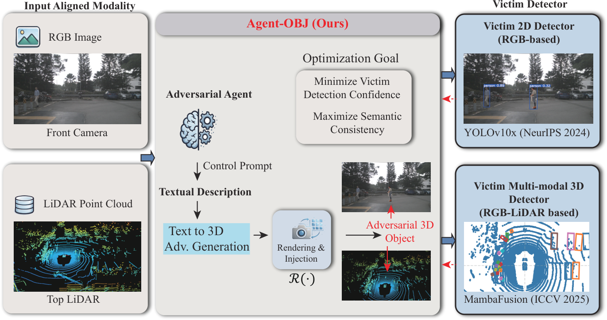
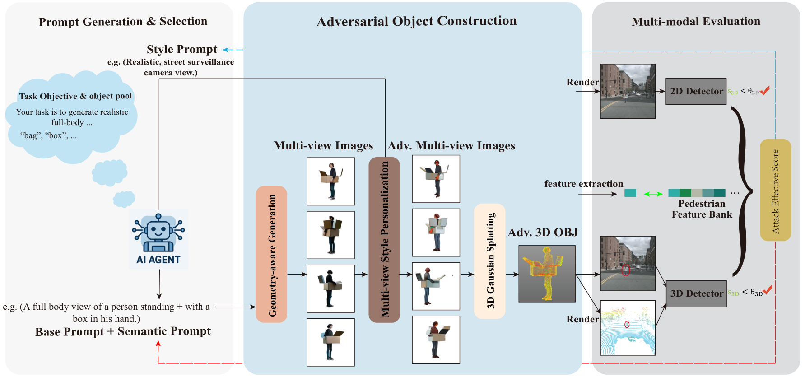

<div align="center">
<h2 align="center">Agent-OBJ: Prompt-Driven 3D Adversaries for Multi-modal Perception</h2>
<h3 align="center">ECCV 2026</h3>

Bing Li<sup>1</sup>, Sean Du<sup>1</sup>, Xuhong Ren<sup>2†</sup>, Luqi Gong<sup>4</sup>, Wee Peng Tay<sup>1</sup>, Qing Guo<sup>2,3†</sup>

<sup>1</sup>Nanyang Technological University, Singapore    <sup>2</sup>NKIARI, Shenzhen Futian, China<br>
<sup>3</sup>AAIS & VCIP, Nankai University, China    <sup>4</sup>Research Center for Space Computing System, Zhejiang Lab, China

<sup>†</sup>Corresponding authors



</div>

This repository provides the official code for **Agent-OBJ**, a prompt-driven agent that generates physically plausible 3D pedestrian adversaries which fool a monocular 2D detector and a Camera-LiDAR fusion 3D detector at the same time.

[[Paper](https://eccv.ecva.net/virtual/2026/poster/5027)]


<details open="open" style='padding: 10px; border-radius:5px 30px 30px 5px; border-style: solid; border-width: 1px;'>
  <summary>Table of Contents</summary>
  <ol>
    <li><a href="#abstract">Abstract</a></li>
    <li><a href="#method">Method</a></li>
    <li><a href="#preparation">Preparation</a></li>
    <li><a href="#quick-start">Quick Start</a></li>
    <li><a href="#running-agent-obj">Running Agent-OBJ</a></li>
    <li><a href="#code-structure">Code Structure</a></li>
    <li><a href="#citation">Citation</a></li>
    <li><a href="#acknowledgment">Acknowledgment</a></li>
    <li><a href="#license">License</a></li>
  </ol>
</details>


## Abstract

Modern autonomous driving systems increasingly rely on tightly coupled Camera-LiDAR fusion pipelines to achieve robust scene understanding. While this multi-modal redundancy is designed to counter independent single-sensor failures, it implicitly assumes that physical objects cannot simultaneously deceive both modalities. In this paper, we expose the vulnerability of this assumption by proposing Agent-OBJ, a generative framework that synthesizes physically plausible 3D adversaries via a prompt-driven agent. Unlike prior works that mainly focus on sensor-specific perturbations, our pipeline instantiates a physically plausible 3D adversary by generating a canonical pedestrian geometry from a base prompt and then modulating its shape via an additional semantic prompt, while controlling appearance with a pretrained multi-view personalization model conditioned on multi-view images and a style prompt to produce view-consistent appearance. To simultaneously compromise both 2D monocular and 3D fusion detectors, the agent dynamically optimizes the generated adversary using confidence-score feedback from both detectors. Meanwhile, to ensure stealthiness, we regularize the generated 3D point cloud by enforcing similarity to a pedestrian feature bank, aligning it with the distribution of natural objects and making it visually and geometrically indistinguishable from benign instances. Furthermore, we incorporate a multi-view consistency constraint during optimization to promote cross-view robustness, ensuring the adversary remains effective under diverse viewpoints in real-world driving scenes. Extensive experiments on nuScenes demonstrate high attack success rates against both monocular and fusion detectors while preserving strong perceptual plausibility.


## Method

<div align="center">

</div>

**Overview of Agent-OBJ.** The adversary is described by three prompts. (a) The **base prompt** and the **semantic prompt** go to MV-Adapter text-to-multi-view, which produces a canonical pedestrian geometry at six azimuths. (b) MV-Adapter image-to-multi-view, conditioned on these views and the **style prompt**, regenerates every view with a consistent appearance. (c) LGM lifts four of the views (0°/90°/180°/270°) to 3D Gaussians, scaled to a 1.7 m pedestrian. The object is rendered from several viewpoints and inserted into a nuScenes keyframe, and the monocular detector (YOLOv10x) and the Camera-LiDAR fusion detector (MambaFusion) return pedestrian confidences. The black-box objective is

$$\mathcal{L} = \mathcal{L}_{atk} + \alpha\,\mathcal{L}_{nat} + \beta\,\mathcal{L}_{mv},\qquad \mathcal{L}_{atk} = \max_v \Big[\lambda_{2D}\,\phi(s^{2D}_v) + \lambda_{F}\,\phi(s^{F}_v)\Big],\quad \phi(s)=\max(0,\,s-\theta)$$

where $\mathcal{L}_{nat}$ is the distance of a PointNet embedding of the object point cloud to a pedestrian feature bank plus a pedestrian box prior, and $\mathcal{L}_{mv}$ is the standard deviation of the per-view attack loss. At every iteration the **EditAgent** reads the optimization history and proposes one discrete edit (add / replace / remove a phrase in the semantic or style prompt). The edit is kept only if it lowers $\mathcal{L}$ (Algorithm 1). An attack succeeds when every view is below the threshold $\theta$ for both detectors.


## Preparation

### Environment

* The code has been tested on Linux with a single NVIDIA L40 (48 GB) GPU.

| Environment | Python | PyTorch | CUDA | Used for |
| --- | --- | --- | --- | --- |
| `agentobj` | 3.10 | 2.5.1 | 12.4 | EditAgent, MV-Adapter, LGM, YOLOv10x, optimization loop |
| `mambafusion` | 3.8 | 2.1.0 | 11.8 | MambaFusion inference and nuScenes insertion |

* Clone the repository together with its submodules ([LGM](https://github.com/3DTopia/LGM), [MV-Adapter](https://github.com/huanngzh/MV-Adapter), [MambaFusion](https://github.com/AutoLab-SAI-SJTU/MambaFusion)):
  ```shell
  git clone --recursive https://github.com/libingsy/agentobj.git
  cd agentobj
  # if you cloned without --recursive:
  # git submodule update --init --recursive
  ```
* Create the Agent-OBJ environment:
  ```shell
  conda create -n agentobj python=3.10
  conda activate agentobj
  # adjust the CUDA version accordingly
  pip install torch==2.5.1 torchvision==0.20.1 --index-url https://download.pytorch.org/whl/cu124
  pip install -r requirements.txt
  ```
* Create the MambaFusion environment (needs `nvcc` 11.8 and gcc ≤ 11). `CUDA_ARCHS` limits the kernel build to your GPU, e.g. `86` for A6000/RTX 3090, `89` for L40/RTX 4090:
  ```shell
  CUDA_ARCHS=89 bash tools/setup_mambafusion.sh
  ```
  Only needed for the Camera-LiDAR detector; the [Quick Start](#quick-start) runs without it.


### Data

Download the [nuScenes](https://www.nuscenes.org/download) v1.0-trainval dataset and link it into the repository. Only keyframes are used, so `samples/` (camera images and LiDAR) and the metadata tables are enough:
```
code_root/
└── data/
    └── nuscenes/
        ├── samples/
        └── v1.0-trainval/
```
Any other location works as well: set `paths.nuscenes_root` in the config, or the `NUSCENES_ROOT` environment variable for the standalone MambaFusion scripts. MambaFusion's info pickles are not needed; the worker builds each frame from the nuScenes devkit.


### Checkpoints

```shell
bash tools/download_weights.sh   # LGM and YOLOv10x
```

| Model | Role | Location |
| --- | --- | --- |
| [LGM](https://huggingface.co/ashawkey/LGM) `model_fp16_fixrot.safetensors` | multi-view → 3D Gaussians | `pretrained/LGM/` |
| [YOLOv10x](https://github.com/ultralytics/assets/releases) `yolov10x.pt` | monocular 2D detector | `pretrained/` |
| [MV-Adapter](https://huggingface.co/huanngzh/mv-adapter) (SDXL T2MV + I2MV) | geometry and appearance | Hugging Face cache (automatic) |
| [SDXL base 1.0](https://huggingface.co/stabilityai/stable-diffusion-xl-base-1.0) + [SDXL-VAE-fp16-fix](https://huggingface.co/madebyollin/sdxl-vae-fp16-fix) | MV-Adapter backbone | Hugging Face cache (automatic) |
| [MambaFusion](https://drive.google.com/drive/folders/1TqvpIHA7plzoFdnGWvFgVYr45bgz-nQ3?usp=sharing) `checkpoint_epoch_10.pth` | Camera-LiDAR 3D detector | `third_party/MambaFusion/ckpts/` |
| [MambaFusion Hilbert templates](https://drive.google.com/drive/folders/1huzbUotusvePvsR-DyGJc6qfX0Cwubvd?usp=sharing) | required by MambaFusion | `third_party/MambaFusion/ckpts/hilbert_template/` |
| [Qwen2.5-7B-Instruct](https://huggingface.co/Qwen/Qwen2.5-7B-Instruct) (optional, `--use_llm`) | LLM EditAgent | Hugging Face cache (automatic) |

The MambaFusion checkpoint can live elsewhere if you export `MAMBAFUSION_CKPT=/path/to/checkpoint_epoch_10.pth`. To check the MambaFusion build and checkpoint:
```shell
conda activate mambafusion
python scripts/smoke_mambafusion.py
```

### Pedestrian feature bank (optional)

$\mathcal{L}_{nat}$ compares the generated point cloud with a bank of standard
PointNet (Qi et al., 2017) features of real pedestrians. The encoder is the
PointNet classification backbone (`regularizers/pointnet.py`, 1024-d global
feature); pass a checkpoint in the [yanx27](https://github.com/yanx27/Pointnet_Pointnet2_pytorch)
format with `--pointnet_ckpt` so the bank is built with trained weights. The
encoder is saved inside the bank and reloaded at attack time, so the bank and
the query always use the same weights.

The bank clouds must be in the generator's **y-up object frame** (up = +y, feet
near y = 0) — the same frame as the generated object — so L_nat compares like
with like. Rotate real LiDAR (z-up) pedestrian clouds into that frame first;
otherwise the cosine distance measures the axis difference, not naturalness.

```shell
python scripts/build_feature_bank.py \
    --clouds /path/to/pedestrian_clouds \
    --pointnet_ckpt pretrained/pointnet/pointnet_cls.pth \
    --output data/pedestrian_feature_bank.pt
```

A standard checkpoint is trained on ModelNet40; train the encoder on pedestrian
point clouds for a domain-matched term. Without `--pointnet_ckpt`,
`build_feature_bank.py` needs the explicit `--allow-random-encoder` flag to build
with a randomly initialised encoder. Without a bank, $\mathcal{L}_{nat}$ uses the
pedestrian box prior.


## Quick Start

The loop can be checked without any weights. Without `--use_real_models`, a prompt-conditioned stand-in replaces the generator and the detectors, so this runs on a CPU in seconds:
```shell
python scripts/run_full_attack.py --config configs/default.yaml --max_iters 20
python -m unittest discover -s tests
```


## Running Agent-OBJ

All commands are run from the repository root in the `agentobj` environment. The full-pipeline settings are in [`configs/full.yaml`](configs/full.yaml). Before the first run, set `paths.mambafusion_python` there to the Python of the `mambafusion` environment (printed at the end of `tools/setup_mambafusion.sh`).

#### 1. Generate one 3D pedestrian
```shell
python scripts/generate_object.py --config configs/full.yaml \
    --semantic "carrying a box, holding a shopping bag" \
    --style "wearing a dark jacket and jeans" \
    --output outputs/object
```
This writes the MV-Adapter views (`view_*.png`), the LGM Gaussians (`object.pt`) and the metric point cloud (`points.npy`).

#### 2. Insert into nuScenes and score with both detectors
```shell
python scripts/insert_and_score.py --config configs/full.yaml \
    --object outputs/object --output outputs/benign_baseline \
    --scenes 4 --keyframes 1
```
This runs in the Agent-OBJ environment. It places the pedestrian on the road in front of the ego vehicle in several val keyframes, at the four yaws, and prints YOLO and MambaFusion confidences. MambaFusion is a subprocess (`paths.mambafusion_python`). A benign object should be above 0.5 on both. The montage is `outputs/benign_baseline/strip.jpg`.

#### 3. Optimize the adversary (Algorithm 1)
```shell
python scripts/run_full_attack.py --config configs/full.yaml --use_real_models --max_iters 16
```
Add `--use_llm` to run the paper's EditAgent (Qwen2.5-7B-Instruct), which reads the per-detector confidences from the history and proposes each edit. A real run requires `--use_llm`; without it, edits are sampled from the phrase pools, which needs the explicit `--allow-sampled-edits` flag. Each iteration generates a new object and calls `SceneEvaluator.evaluate` once. The search stops when `asr_joint_all_yaws` is 1: every yaw of every keyframe in `evaluation.sample_token` (or `sample_tokens`) is below `conf_threshold` on both detectors.

Results are written to `outputs/<experiment.name>/`:
```
outputs/agent_obj_directed/
├── history.json      # every proposed edit, its losses, detector scores, accept / reject
├── summary.json      # best prompts, best loss, acceptance rate, attack success
├── best_views/       # renders of the best object (yaw_000.png, ...)
└── cam_front.jpg     # last nuScenes frame scored by MambaFusion
```

#### Main options

| Key | Meaning |
| --- | --- |
| `prompts.base / semantic_init / style_init` | initial prompts |
| `edit_pools.semantic / style` | phrases the EditAgent can add, replace or remove |
| `optimization.max_iterations`, `optimization.viewpoints` | iterations of Algorithm 1 and rendered yaw angles |
| `loss.lambda_2d / lambda_fusion / alpha_nat / beta_mv / conf_threshold` | $\lambda_{2D}$, $\lambda_F$, $\alpha$, $\beta$, $\theta$ |
| `generator.variant` | `sdxl` (768 px, default) or `sd21` (512 px, less memory) |
| `generator.steps_t2mv / steps_i2mv` | diffusion steps of the two MV-Adapter stages |
| `evaluation.sample_token` | nuScenes keyframe used by the fusion detector |


## Code Structure

```
code_root/
├── agent/
│   ├── improved_edit_agent.py   # EditAgent: Qwen2.5 with --use_llm, else edits sampled from the pools
│   └── full_optimizer.py        # Algorithm 1: propose → generate → evaluate → accept / reject
├── generators/
│   ├── generator.py             # T2MV → I2MV → LGM pipeline, and the stand-in generator
│   ├── mvadapter.py             # MV-Adapter T2MV / I2MV (SDXL or SD2.1)
│   ├── lgm_recon.py             # LGM forward_gaussians, metric scaling
│   └── prompts.py               # geometry / appearance prompt assembly
├── detectors/
│   ├── detectors.py             # YOLOv10x and fusion detector wrappers
│   └── fusion_client.py         # client of the MambaFusion worker process
├── regularizers/
│   ├── losses.py                # L_atk, L_nat, L_mv
│   ├── naturalness.py           # L_nat: pedestrian feature bank + box prior
│   └── pointnet.py              # standard PointNet encoder (yanx27-compatible)
├── render/                      # exact 3D Gaussian rasterizer and object renders
├── data/
│   ├── lidar_sensor.py          # LiDAR sweep / beam model and ray-casting
│   ├── object_insert.py         # object placement + camera / LiDAR insertion
│   ├── nuscenes_scene.py        # load a nuScenes sample and place the object in it
│   └── nuscenes_insert.py       # re-export facade (back-compatible imports)
├── eval/
│   ├── evaluator.py             # attack success rate and run summaries
│   └── scene_eval.py            # score an object across keyframes and yaws
├── scripts/
│   ├── run_full_attack.py       # main entry
│   ├── generate_object.py       # generate a single object
│   ├── build_feature_bank.py    # build the pedestrian feature bank
│   ├── mambafusion_worker.py    # MambaFusion scorer (runs in the mambafusion env)
│   ├── insert_and_score.py      # benign insert + YOLO / MambaFusion scores (agentobj env)
│   └── smoke_mambafusion.py     # check the MambaFusion build and checkpoint
├── tools/                       # environment setup, weight download, end-to-end scripts
├── configs/
│   ├── default.yaml             # quick start / stand-in models
│   └── full.yaml                # full pipeline
├── tests/
└── third_party/                 # LGM, MV-Adapter, MambaFusion (git submodules) + patches
```


## Responsible Use

Agent-OBJ is released to help evaluate and improve the robustness of multi-modal perception in autonomous driving. Please use it only for research on and defense of perception systems you are authorized to test.


## Citation

If you find Agent-OBJ useful in your research, please cite our paper:
```
@inproceedings{li2026agentobj,
  title     = {{Agent-OBJ: Prompt-Driven 3D Adversaries for Multi-modal Perception}},
  author    = {Li, Bing and Du, Sean and Ren, Xuhong and Gong, Luqi and Tay, Wee Peng and Guo, Qing},
  booktitle = {European Conference on Computer Vision (ECCV)},
  year      = {2026}
}
```


## Acknowledgment

We thank the authors of the following excellent open-source projects:

* [MV-Adapter](https://github.com/huanngzh/MV-Adapter)
* [LGM](https://github.com/3DTopia/LGM)
* [MambaFusion](https://github.com/AutoLab-SAI-SJTU/MambaFusion) and [OpenPCDet](https://github.com/open-mmlab/OpenPCDet)
* [Ultralytics YOLOv10](https://github.com/ultralytics/ultralytics)
* [Qwen2.5](https://github.com/QwenLM/Qwen2.5)
* [nuScenes devkit](https://github.com/nutonomy/nuscenes-devkit)


## License

This project is released under the [MIT License](LICENSE). The third-party code under `third_party/` (LGM: MIT; MV-Adapter, MambaFusion: Apache-2.0) and the pretrained models keep their original licenses.
